# Orbit UI

给 AI Agent 用的**太空科技感**界面设计 Skill。它先拉开几种明显不同的太空科技方向让你比较，再对着真实画面打磨：任务控制台、轨道蓝图、深空、星际拓荒（参考游戏 Starfield 的 NASA-punk 界面）、全息 HUD、太空竞赛复古……而不是每次都交出“黑底 + 霓虹青 + 粒子背景”。

适用于航天公司官网、发射直播页、卫星数据平台、运维大屏、科幻游戏 HUD，也适用于外卖、电商、钱包、智能家居、运营后台这类日常业务界面。

[English](README.en.md)

<p align="center">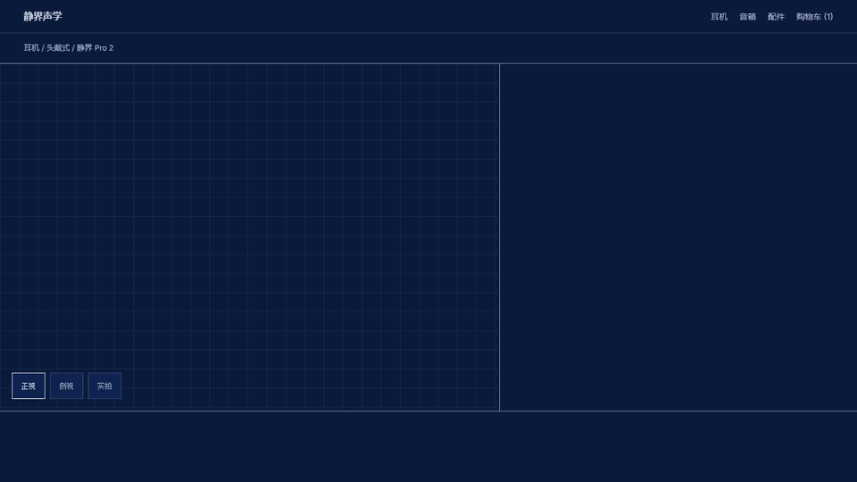</p>

## 看看效果

同一次发射，四个方向：

| 星际拓荒 · frontier | 任务控制台 · mission |
| --- | --- |
| 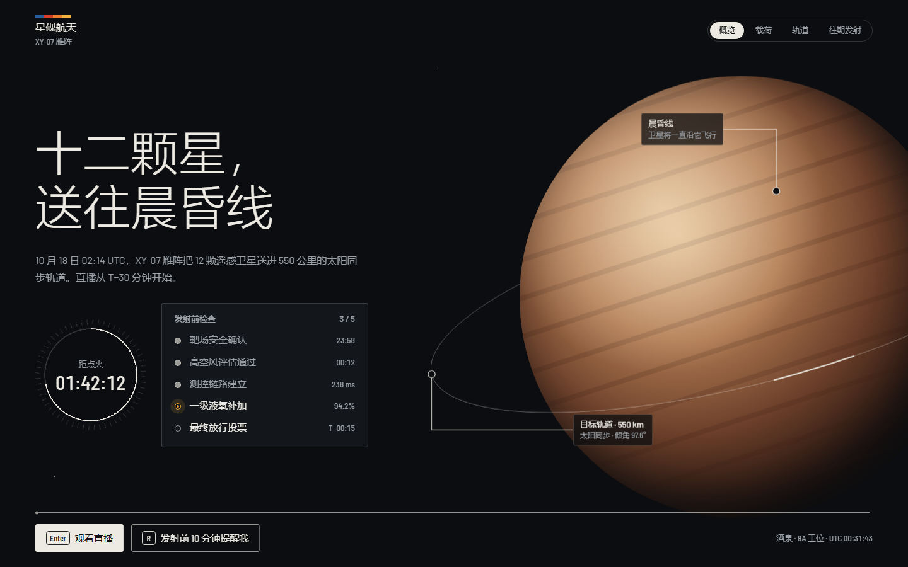 | 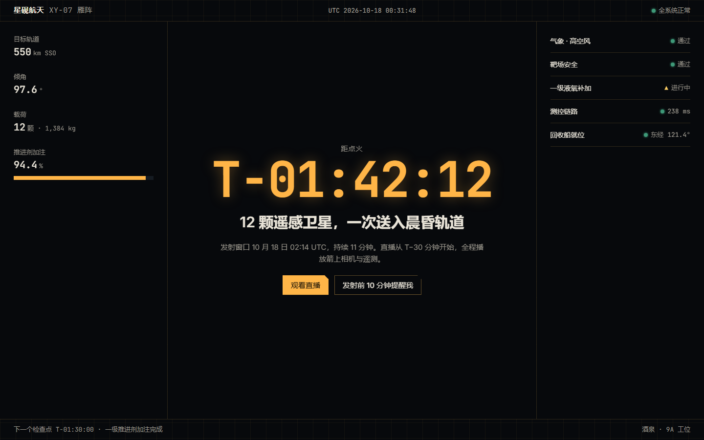 |
| **轨道蓝图 · blueprint** | **深空 · deepfield** |
| 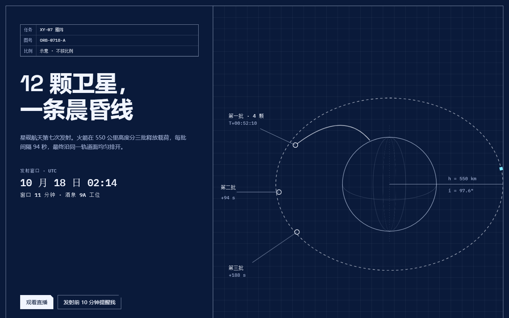 | 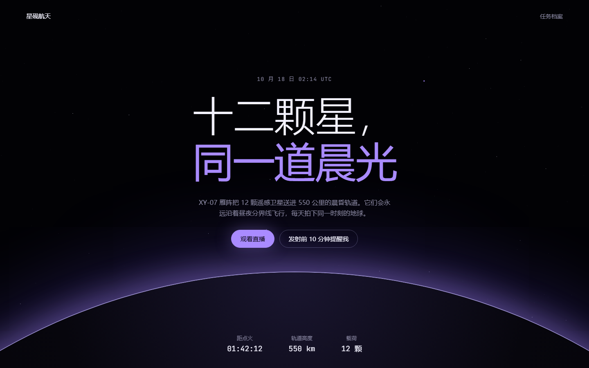 |

日常业务界面：

| 外卖订单追踪 | 智能家居 | 个人账户 |
| --- | --- | --- |
| 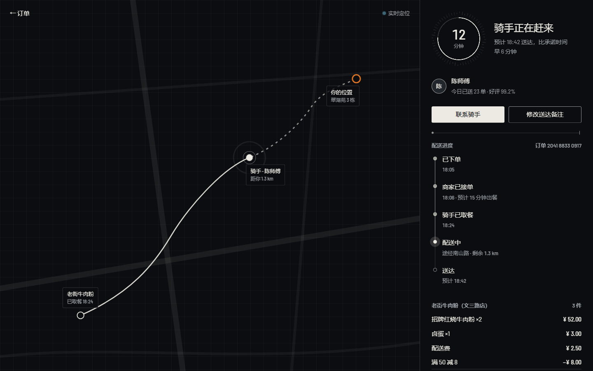 | 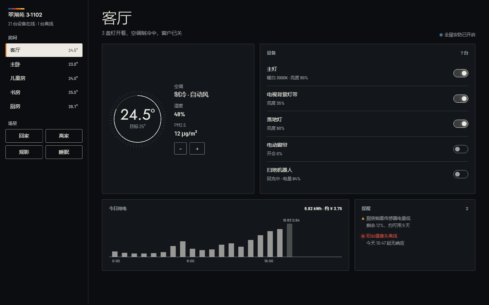 | 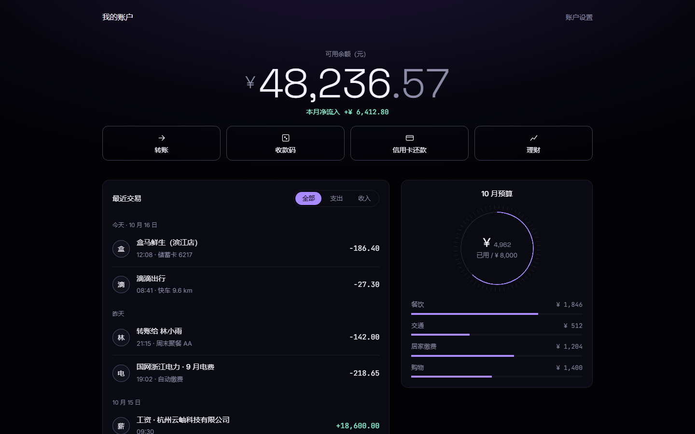 |
| **商品详情** | **跑步记录** | **门店运营看板** |
| 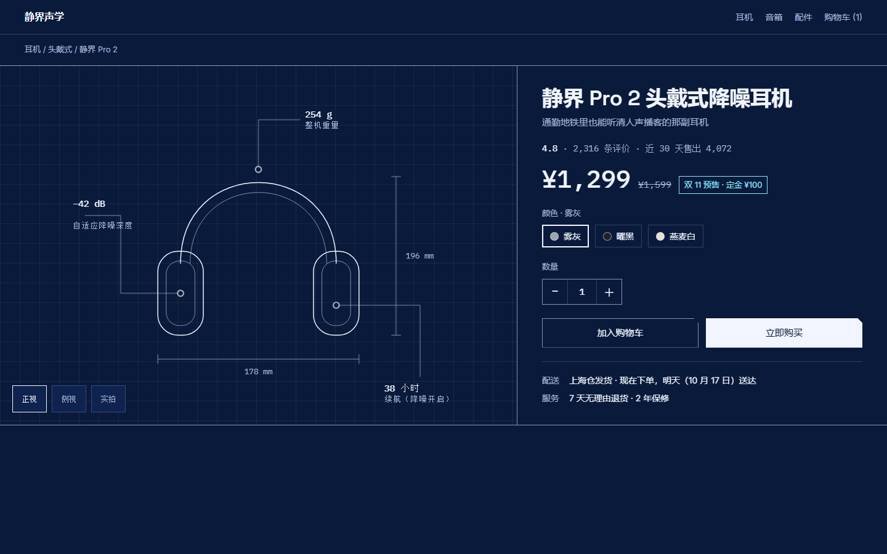 | 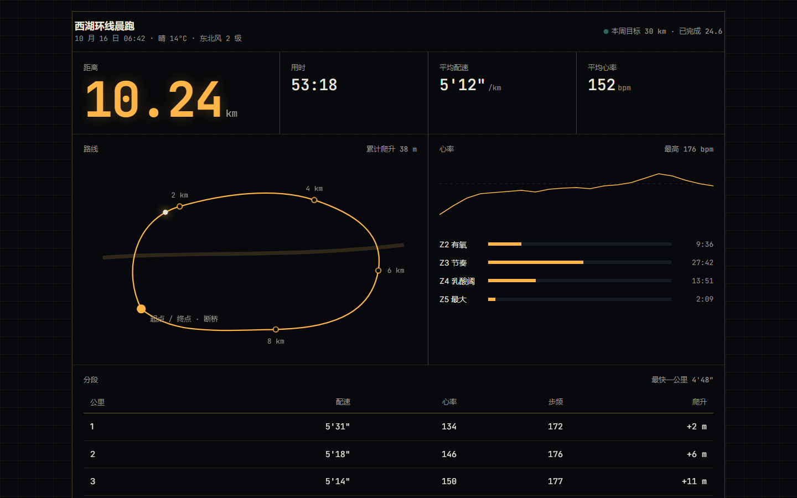 | 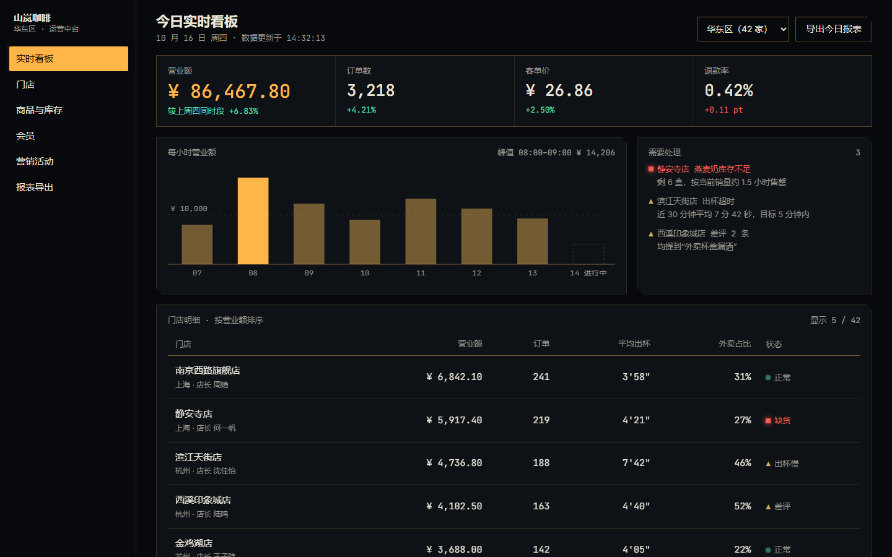 |

控件总览（可切换四套色板）：

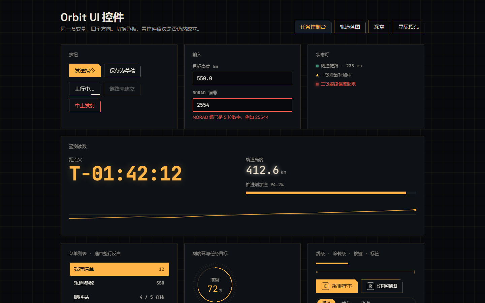

页面里的动效都很克制：引线和轨迹被一笔画出，刻度环从 0 读到当前值，倒计时和营业额在跳，状态灯在呼吸。截图看不出来，在本地打开 `examples/` 里的页面就能看到。

## 它怎么工作

1. **认品类，拆标杆。** 先判断产品属于哪一类，找同类里风格最鲜明的两三家（SpaceX 直播、NASA Eyes、Planet、电影界面……），拆出看得见的要素。
2. **把“科技感”翻译成决定。** “科技感”“未来感”“高级”不能当设计理由：翻译成等宽数字、线的含义、强调色面积、装饰语言数量。
3. **从方向谱里挑三个真正不同的方向。** 骨架、字体、色彩、主视觉四项里，任意两个方向最多一项相同。
4. **先用文字问你。** 每个方向三四行描述，附推荐理由；你想看画面时，再做成三张首屏放进对比页。
5. **仪器的诚实。** 每条线都在测量什么，每处光都来自一个真实信号；全页装饰语言最多两种。
6. **只在一两处做到极致。** 倒计时归零、读数刷新、指令上行回显……其余保持安静。
7. **截图检查，做减法。** 桌面和手机各截一张，深色界面特别查对比度、细线和等宽数字。

## 安装

```bash
npx skills add pei92/orbit-ui
```

或者直接把本目录复制到 Agent 的 Skill 目录（Claude Code 为 `~/.claude/skills/orbit-ui`）。无需额外配置。

## 用法示例

- “给我们的卫星遥测平台设计首页，要有太空科技感。”
- “做三种风格差异明显的发射直播页，放进对比页让我选。”
- “这个运维大屏太像普通后台了，按 orbit-ui 的方式加一点仪器感，但别全站铺网格。”
- “只评审这个 HUD，不改文件。”

## 目录

```text
orbit-ui/
├─ SKILL.md                     Skill 入口：流程与范围
├─ references/
│  ├─ design-direction.md       品类、调性、太空科技方向谱、方向卡、差异检验
│  ├─ visual-language.md        字体与数字、色彩与发光、面板、控件语法、默认做法清单
│  ├─ motion.md                 仪器刷新与天体运动、启动序列、滚动叙事
│  ├─ media.md                  NASA / ESA 等开放素材与许可
│  ├─ business-scenarios.md     日常业务：对象翻译表、剂量、不能变的东西
│  ├─ style-explorer.md         风格对比页的 manifest 写法
│  ├─ visual-review.md          10 分制评审清单
│  └─ tools.md                  工具用法
├─ assets/
│  ├─ orbit.css                 设计令牌 + 控件 + 线条与动效原语（mission / blueprint / deepfield / frontier 四套色板）
│  ├─ icons/                    46 个线性图标源文件（星体与航天 + 日常业务），构建进 orbit.css
│  └─ style-explorer.html       对比页模板
├─ scripts/
│  ├─ build_explorer.py         manifest → 离线单文件对比页（Python 标准库）
│  ├─ build_icons.py            assets/icons → orbit.css 的 .o-icon--名字 类
│  └─ shoot.mjs                 无依赖截图（调用本机 Chrome / Edge 无头模式）
├─ examples/
│  ├─ components.html           控件总览，可切换四套色板（?orbit=frontier 直接打开）
│  ├─ launch-page/              一轮完整示例：四个方向首屏 + manifest + 生成的对比页
│  └─ scenarios/                日常业务：外卖追踪、智能家居、钱包、商品详情、跑步记录、门店看板（index.html 总览）
├─ docs/screenshots/           README 里的截图
└─ tests/
```

## 试一下

```bash
python scripts/build_explorer.py examples/launch-page/manifest.json --force
```

打开 `examples/launch-page/style-explorer.html`：并排或单张查看，切换桌面 / 手机，←→ 翻页，点“选择”复制一句话发给 Agent。

```bash
node scripts/shoot.mjs examples/components.html --size both
```

```bash
python -m unittest discover tests
```

## 致谢

流程结构参考了 [oil-oil/oil-ui](https://github.com/oil-oil/oil-ui)（MIT）。本项目的文本、样式与脚本为重新编写，聚焦太空科技方向。

## 许可

MIT
